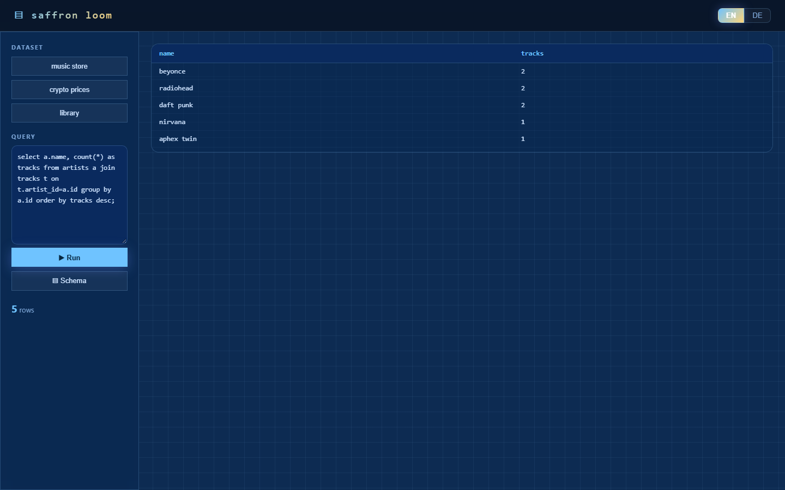
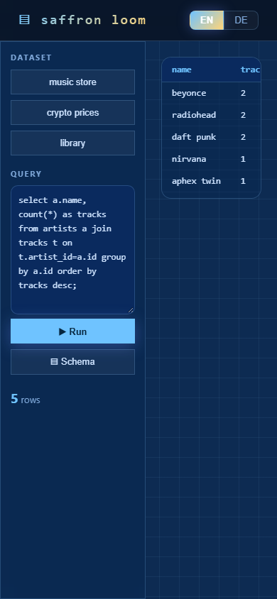

# Saffron Loom — Sql Lab

A real SQLite playground in the browser via sql.js WebAssembly: library dataset, query editor with Ctrl+Enter, results table and schema browser.

<div align="center">


-orange)


**[Live Demo](https://ruslanfridenli.github.io/saffron-loom/)** · **[Deutsch ↓](#-deutsch)**

</div>

---

## Screenshots






## Features

- Real SQLite engine via sql.js WebAssembly
- Preloaded library sample database
- Query editor with Ctrl/Cmd+Enter shortcut
- Schema browser for all tables
- Works fully offline after CDN load
- English/German interface

## Local development

```bash
git clone https://github.com/ruslanfridenli/saffron-loom.git
cd saffron-loom
# open index.html in a browser, or serve statically:
npx serve .
```

No build step, no dependencies — pure static site.

---

## 🇩🇪 Deutsch

### Saffron Loom — Sql Lab

Ein echter SQLite-Playground im Browser via sql.js WebAssembly: Bibliothek-Datensatz, Query-Editor mit Strg+Enter, Ergebnistabelle und Schema-Browser.

### Funktionen

- Echte SQLite-Engine via sql.js WebAssembly
- Vorgeladene Bibliotheks-Beispieldatenbank
- Query-Editor mit Strg+Enter
- Schema-Browser für alle Tabellen
- Funktioniert nach CDN-Ladung offline
- Englische/deutsche Oberfläche

### Lokale Entwicklung

```bash
git clone https://github.com/ruslanfridenli/saffron-loom.git
cd saffron-loom
npx serve .
```

Reine statische Seite — kein Build-Schritt, keine Abhängigkeiten.

---

## ☕ Support / Unterstützen

Wenn dir diese Website beim Lernen hilft, würde mir eine Spende sehr viel bedeuten und dabei helfen, sie weiterzuentwickeln. Alternativ kannst du das Projekt mit einem Stern im github repo unterstützen. Vielen Dank!

- Solana: `zQpgZ6nGigww7vYpz3Qqxb1BT44kqS567vFaLTeHagS`
- Ethereum: `0x9c4fE1B2e9a1A9c22312c8296BB088Ca0e8F1B4e`
- Bitcoin: `bc1p2jltk9ya9kyzv35d8kxn7mmg9jqkx66cqtgzqwe75zlr4v9jk4hsv468q7`

---

Made with care. Feedback welcome via issues.
